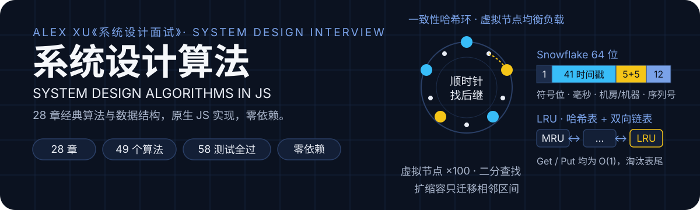

<p align="right"><a href="README.en.md">English</a></p>

<p align="center">
  
</p>

<p align="center">
  <a href="https://xiaosang.cc/system-design-algorithms-js/">▶ 在线实验室</a>
  ·
  <a href="https://github.com/holynova/system-design-algorithms-js">GitHub 仓库</a>
</p>

系统设计算法 JS 是 Alex Xu《System Design Interview: An Insider's Guide》第一卷与第二卷全部 28 章的经典算法与数据结构实现，用原生 JavaScript（Node.js ES Modules）手写，零第三方依赖。每个算法文件自包含可运行的演示，附 58 个单元测试与一个可交互的 Web 实验室。

## 截图

<p align="center">
  
</p>

## 目录

完整目录与复杂度见 [`CATALOG.md`](./CATALOG.md)。第一卷 15 章、第二卷 13 章，共 49 个算法模块：

**第一卷：系统设计核心组件（15 章）**

| 章 | 主题 | 核心算法 |
|:---|:---|:---|
| 01 | 从零到百万用户 | LRU / LFU 缓存（O(1) 双向链表 + Map） |
| 02 | 粗略估算 | 容量计算器、Jeff Dean 延迟表 |
| 03 | 面试框架 | 4 步法评估器与自查清单 |
| 04 | 限流器 | 令牌桶、漏桶、固定窗口、滑动窗口日志/计数器 |
| 05 | 一致性哈希 | 哈希环、虚拟节点（默认 ×100）、二分顺时针查找 |
| 06 | KV 存储 | 向量时钟、默克尔树、布隆过滤器、Gossip、Quorum |
| 07 | 分布式唯一 ID | Snowflake 雪花算法（64 位 BigInt，时钟回拨防御） |
| 08 | 短网址 | Base62 编解码、截断哈希加盐探测 |
| 09 | 网络爬虫 | 礼貌 URL Frontier、SimHash |
| 10 | 通知系统 | 指数退避（Full/Equal Jitter）、幂等去重器 |
| 11 | 新闻提要 | 混合扇出、K 路时间线归并 |
| 12 | 聊天系统 | 消息定序器、在线状态管理 |
| 13 | 搜索自动补全 | Top-K 前缀树（Trie） |
| 14 | YouTube | DAG 任务调度器（拓扑排序 + 环检测） |
| 15 | Google Drive | 块级差量同步与去重 |

**第二卷：高并发实战系统（13 章）**

| 章 | 主题 | 核心算法 |
|:---|:---|:---|
| 01 | 邻近服务 | GeoHash、四叉树 |
| 02 | 附近的好友 | Haversine 距离、网格发布订阅 |
| 03 | 谷歌地图 | A* 寻路、Slippy Map 瓦片换算 |
| 04 | 消息队列 | 分段提交日志、分区分配器（Range / Round-Robin） |
| 05 | 指标监控 | 时序降采样、滑动窗口告警评估 |
| 06 | 广告聚合 | 水位线流窗口（迟到事件旁路输出） |
| 07 | 酒店预订 | 跨日期库存防超卖（乐观锁 + TTL 租期） |
| 08 | 邮件服务 | 倒排索引、布尔检索 |
| 09 | S3 对象存储 | 纠删码（N 数据块 + M 校验块） |
| 10 | 游戏排行榜 | 跳表（Redis ZSET 底层，O(log N) Rank） |
| 11 | 支付系统 | 复式记账账本、双向对账 |
| 12 | 数字钱包 | Saga 编排器、两阶段提交（2PC） |
| 13 | 股票交易所 | 撮合引擎与限价订单簿（价格-时间优先） |

## 快速上手

零依赖，Node.js ≥ 18，无需 `npm install`：

```bash
git clone https://github.com/holynova/system-design-algorithms-js.git
cd system-design-algorithms-js

npm test        # 58 个测试，30 个套件，实测 58 通过 / 0 失败
npm run web     # 本地 Web 实验室，打开 http://localhost:3000
npm run demo    # 全算法终端演示

# 单个算法直接跑（每个文件自带 Demo）
node src/v2/ch10-leaderboard/skip-list.js
node src/v1/ch05-consistent-hash/consistent-hash-ring.js
node src/v1/ch04-rate-limiter/token-bucket.js
```

## 交互实验室

`index.html` + `web/` 是 28 章的在线实验室：每章有场景背景、原理讲解、SVG 架构图、Mermaid 时序图与源码浏览器，还有可调参的操练台——限流器流量注入、雪花 ID 生成与逆向解析、哈希环扩缩容模拟、订单簿实时撮合。支持搜索与深浅主题切换。

## 技术

- 纯 Node.js 原生 ES Modules，零 npm 依赖；测试用 Node 内置 `node:test`。
- 教学注释详尽：每个文件顶部有原书背景、数学模型、ASCII 拓扑与复杂度分析。
- 防御性设计：时钟回拨、哈希环回绕、同分平局、边界截断等工业级坑点均有处理。

```
src/index.js            统一导出入口
src/v1/                 第一卷 15 章（ch01-cache … ch15-google-drive）
src/v2/                 第二卷 13 章（ch01-proximity … ch13-exchange）
test/v1.test.js         第一卷测试（37 个用例）
test/v2.test.js         第二卷测试（21 个用例）
examples/               全算法终端演示入口
web/                    交互实验室（app.js / data.js / svg-diagrams.js）
CATALOG.md              28 章全景索引与复杂度表
```
